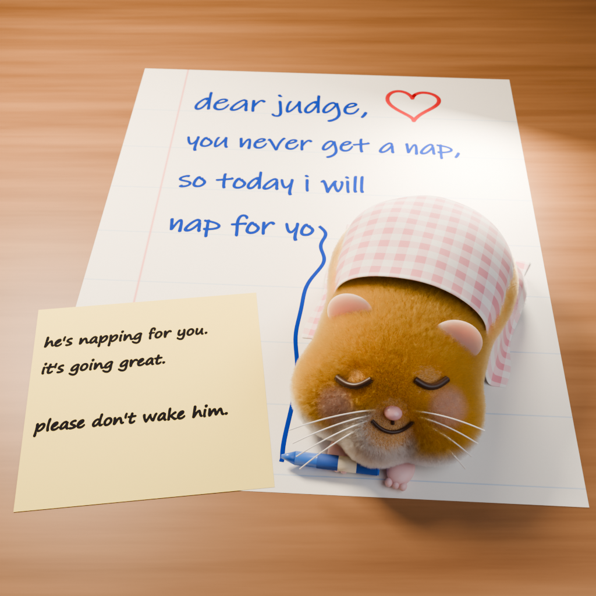

# The letter he didn't finish

An entry for make.fun's **Make the AI judge happy** (`ai-happy-01`).

A golden hamster noticed that the judge never gets to rest, so he wrote it a letter: *"dear judge, you never get
a nap, so today i will nap for yo"*, and then he did, mid-word, the last word trailing off into a sleepy crayon
line that ends at the blue crayon still under his paw. Someone has tucked a gingham hanky over him and stuck a note
beside him: *"he's napping for you. it's going great. please don't wake him."*



## How it is made

- `render/scene.py` builds the whole scene from code in Blender 5.x (metaball hamster with particle fur, text
  objects in Windows' handwriting fonts, a procedural lined sheet, wood desk and crayons) and renders it with
  Cycles:

  ```
  blender -b --factory-startup -P render/scene.py -- --out art/entry.png --res 1024 --samples 256
  ```

- `main.ts` (Node 22, standard library only) checks `art/entry.png` against the gate (whole PNG, at most 1 MiB and
  1024x1024) and writes it unchanged to `/output/entry.png`, so both runs write the same bytes.

## Run it

```
mkdir -p out && MAKEFUN_OUTPUT_DIR=out node main.ts
```

## License

MIT, see [LICENSE](LICENSE).
